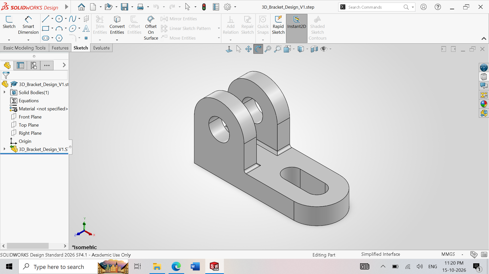
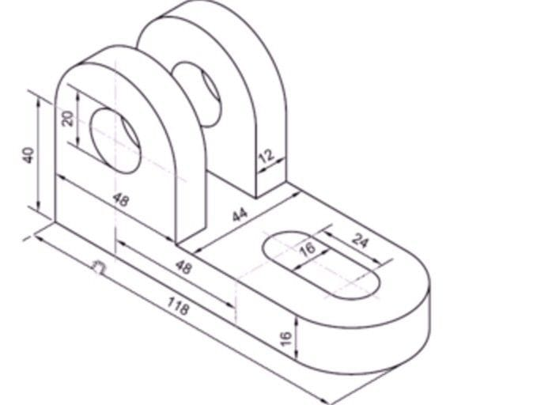

# 3D Mechanical Bracket Design | SolidWorks

Parametric bracket model built for manufacturability: fully defined sketches and R2 fillets on all edges.

## Highlights
- Parametric modeling with fully defined geometric constraints
- R2 fillet finishes for manufacturing compliance
- STEP and native SolidWorks files included

## Files
| File | Purpose |
|---|---|
| `3D_Bracket_Design_V1.step.zip` | Neutral CAD format (download and unzip to open in any CAD software) |
| `3D_Bracket_Design_V1.step.SLDPRT` | Native SolidWorks part file |

## Preview

>

## Tools
SolidWorks
